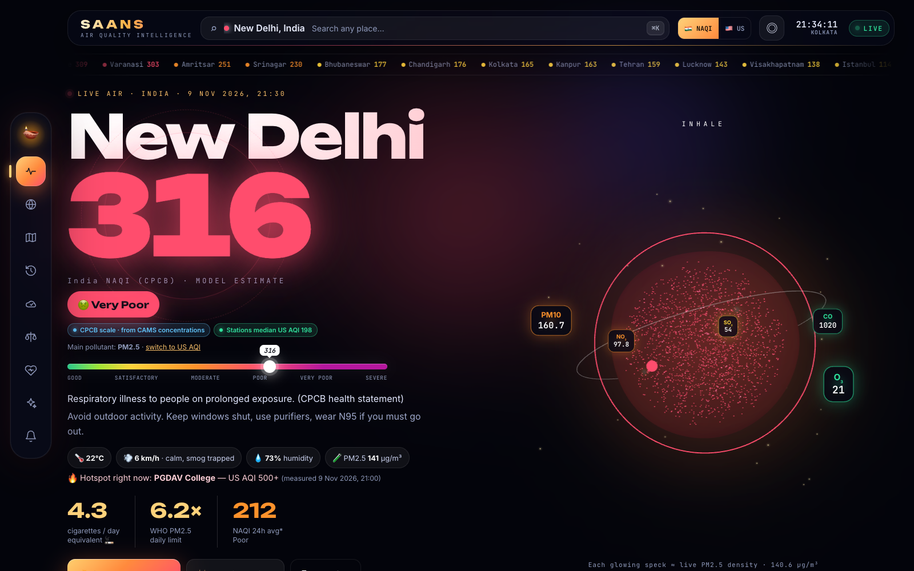
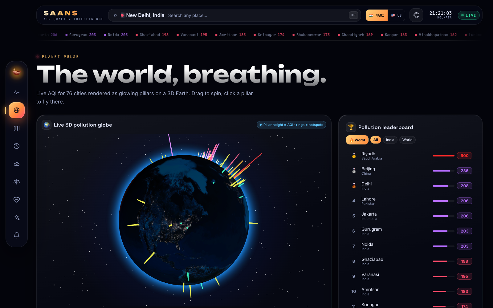
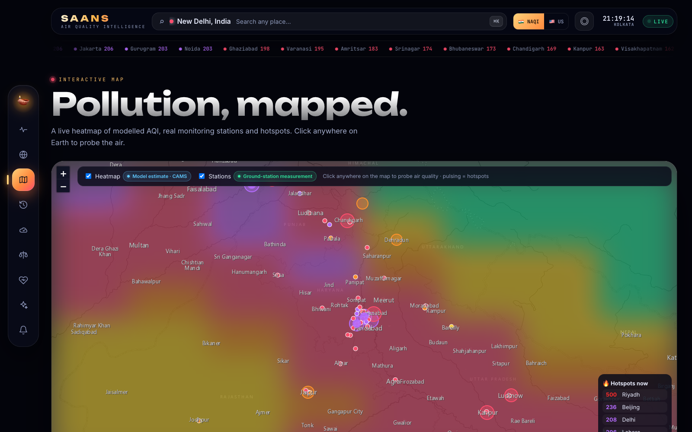
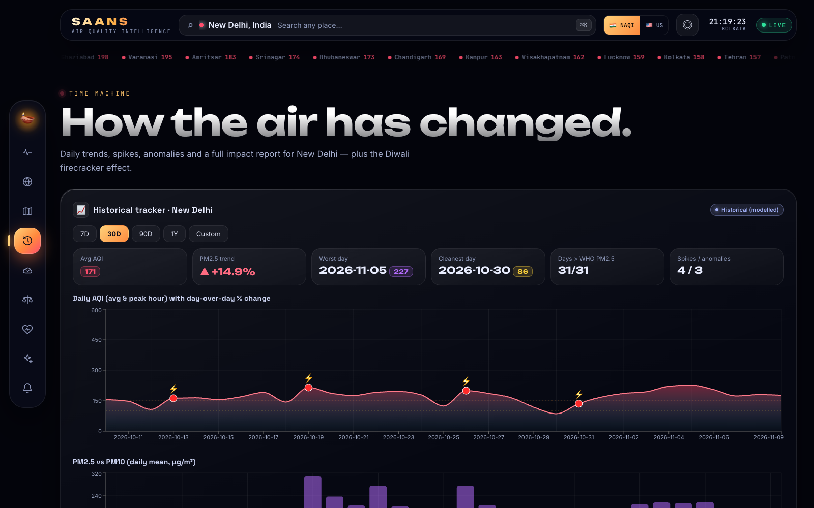
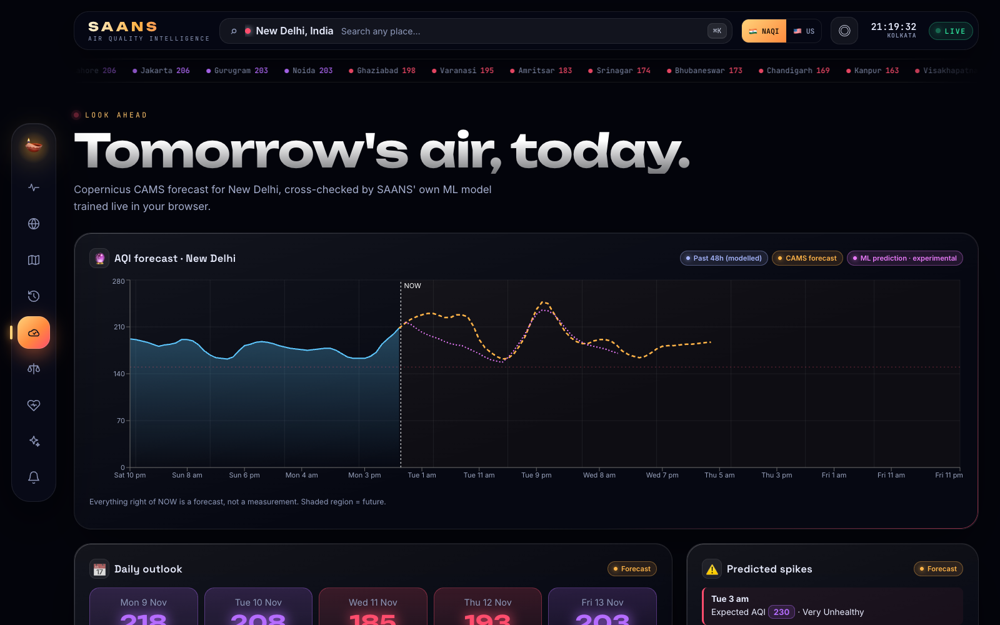
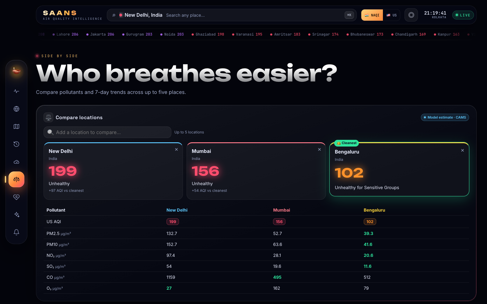
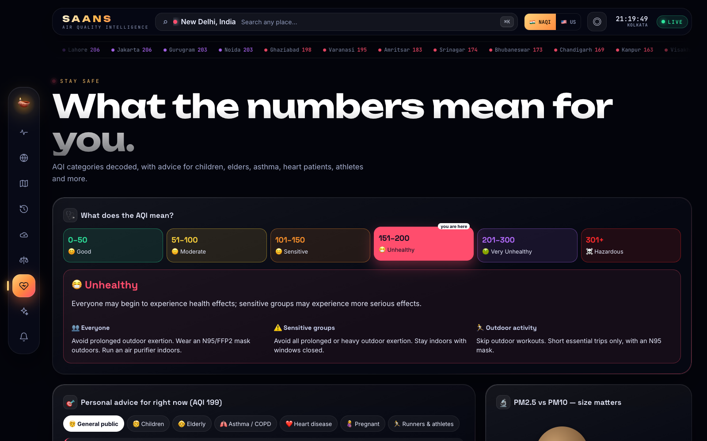

# 🪔 SAANS — Real-Time Air Quality Intelligence

> **SAANS** (साँस) means *breath*. SAANS turns raw, real-world air-quality data into a living 3D experience you can act on. It shows the air you breathe right now, what it means for your health, and when it will get better.

Built for the **Let's Code Diwali Challenge 2026 — Breathe Better**.

**🔗 Live demo:** `<your-vercel-url>`  **🎬 Demo video:** `<your-video-link>`  **📦 Repo:** `<your-github-url>`



| 3D Globe + leaderboard | Live map + heatmap | History + Diwali effect |
|---|---|---|
|  |  |  |
| **Forecast + ML** | **Compare** | **Health & safety** |
|  |  |  |

---

## ✨ Why SAANS is different

| | |
|---|---|
| 🇮🇳 **India NAQI ⇄ US AQI, everywhere** | One switch changes every page to the scale you choose: dashboard, ticker, 3D globe, map, history, forecast, compare, health, alerts, share card and AI. India defaults to CPCB NAQI, which is the number people see on Indian news and apps. |
| 📡 **Measured vs. modelled, side by side** | The Copernicus CAMS model runs next to nearby ground stations (WAQI). The app shows the station median and the worst hotspot (e.g. *Anand Vihar*). Every value is tagged **Measured / Model estimate / Forecast / ML**. |
| 🫁 **3D breathing orb** | A glass sphere breathes in and out every 4 s. Its particle density follows live PM2.5, and the pollutants orbit it as glowing chips. |
| 🌍 **3D pollution globe** | 76 cities as glowing AQI pillars on a night-lights Earth. Pulsing rings mark hotspots, and you can click a pillar to fly there. |
| 🪔 **Diwali Effect** | Lines up PM2.5 around every Diwali since 2023 (including 8 Nov 2026) to show the impact of firecrackers. |
| 🧠 **In-browser ML** | Ridge-regression model with weather features, trained live on 30 days of data. It is back-tested against a persistence baseline, and its error and skill are shown in the app. |
| ✨ **Gemini AI** | A one-click AI briefing and a voice chat assistant in English, Hindi or Hinglish. It only uses the live numbers and never invents readings. |
| 🚬 **Health in human terms** | Cigarettes-per-day equivalent, WHO-guideline multiples, CPCB/EPA health statements and advice for 7 sensitive groups. |

## 🎨 UI / UX

- **Visual style:** dark glass design.
  - Animated aurora background, and a 3D smog-particle backdrop whose density and colour follow the current AQI.
  - Golden "diya" sparks floating in the background.
- **Hero section:** the city name in large display type with a shimmer, and a count-up AQI number with a pulsing halo.
  - A colour **AQI scale meter** with a "you are here" pin.
  - Weather pills (temperature, wind, humidity) and a live clock.
- **Cards:** bento grid with **3D tilt**, cursor spotlight, animated conic-gradient glowing borders and scroll-reveal animations.
- **Navigation:** floating side dock with custom icons, **⌘K command-palette search**, a live city ticker and editorial page headers.
- **Platforms:** responsive (the dock moves to the bottom on mobile), respects `prefers-reduced-motion`, and ships a PWA manifest and Open Graph tags.

## ✅ Mandatory features

- **A. Live AQI dashboard**
  - Headline AQI on the chosen scale, with category and CPCB/EPA health statement.
  - PM2.5 / PM10 / NO₂ / SO₂ / CO / O₃, each with its WHO-guideline multiple.
  - European AQI, UV index and NAQI 24 h average.
  - Data source and last-updated timestamp in the location's timezone.
  - Nearby monitoring stations and the hotspot.
- **B. Interactive map**
  - Leaflet map with dark Esri tiles and a blurred heatmap.
  - Colour-coded city markers and real WAQI stations in view.
  - **Click anywhere** for full pollutant details.
  - Pulsing hotspots, a hotspot list and a legend for the chosen scale.
- **C. Historical tracker**
  - 7D / 30D / 90D / 1Y / custom ranges (data since Aug 2022), with daily average and peak-hour chart.
  - PM2.5 vs PM10 chart, day-over-day % change and ⚡ spike markers.
  - Two-date hourly comparison with % change, and anomaly events.
- **D. Location comparison**
  - Up to 5 places, a pollutant table (best value highlighted) and a 7-day trend overlay.
  - Grouped pollutant bars and a 👑 cleanest-location badge.
- **E. Health & safety**
  - Interactive category scale with "you are here".
  - Advice for children, elders, asthma/COPD, heart patients, pregnant women and athletes.
  - Mask, indoor and commute tips, a PM2.5 vs PM10 size visual, an **India NAQI vs US AQI explainer table** and a pollutant guide.
- **F. AQI forecast**
  - 5-day CAMS forecast with a clear **NOW** divider and shaded future.
  - Daily outlook cards, predicted spikes and the best 2-hour outdoor window.
  - An ML prediction overlaid on the chart.

## 🏅 Bonus features (13/13)

1. **AI AQI assistant:** Google Gemini (or Groq/OpenAI) behind a serverless proxy, plus a one-click **AI briefing**. Without a key, a built-in engine answers using the live data.
2. **Smart AQI alerts:** a threshold per location on the chosen scale, browser notifications and in-app toasts, plus **forecast-based early warnings**.
3. **ML-based prediction:** ridge regression on lagged PM2.5 + wind, humidity, boundary-layer height, temperature and rain. The back-test error and skill are shown honestly.
4. **Pollution heatmap:** a colour-graded, blurred grid of modelled AQI over the visible map area.
5. **Location-based AQI:** "◎ Near me" uses geolocation and reverse geocoding.
6. **Clean Air Finder:** scans 32 points up to 160 km around you for relatively cleaner air.
7. **AQI sharing cards:** generates a 1080×1350 PNG to download or share via Web Share.
8. **Pollution impact report:** an automated, downloadable Markdown report with averages, worst/best day, WHO exceedance, spikes and cumulative cigarettes.
9. **Pollution leaderboard:** 76 cities, worst-first or cleanest-first, filtered by All / India / World.
10. **Voice assistant:** Web Speech API for speech recognition and speech output.
11. **Anomaly detection:** robust z-score (rolling median/MAD) on hourly PM2.5, merged into events.
12. **Multi-API integration:** 7 public data sources (below).
13. **AI insights:** plain-language summaries generated from the live numbers.

Plus: Diwali Effect, shareable URLs (`?lat=&lon=&name=`), auto-refresh every 10 min, and an offline / stale-cache fallback.

## 🔌 Public APIs (credited in-app)

| API | Used for | Data type | Key |
|---|---|---|---|
| [Open-Meteo Air Quality](https://open-meteo.com/en/docs/air-quality-api) (Copernicus CAMS) | current, hourly history (since 2022), 5-day forecast, multi-city | **Model estimate / forecast** | none |
| [WAQI / aqicn.org](https://aqicn.org/api/) | nearby stations, hotspot, stations on the map | **Ground-station measurement** | optional `WAQI_TOKEN` |
| [CPCB via data.gov.in](https://data.gov.in/resource/real-time-air-quality-index-various-locations) | official NAQI per station (24 h avg) | **Official measurement** | optional `DATAGOV_API_KEY` |
| [Open-Meteo Weather](https://open-meteo.com/en/docs) | wind, humidity, boundary layer (insights + ML) | model | none |
| [Open-Meteo Geocoding](https://open-meteo.com/en/docs/geocoding-api) | place search | — | none |
| [BigDataCloud reverse geocoding](https://www.bigdatacloud.com/free-api/free-reverse-geocode-to-city-api) | names for "Near me" / map probe | — | none |
| [Google Gemini](https://aistudio.google.com/apikey) (or Groq / OpenAI) | AI assistant + AI briefing | — | optional `GEMINI_API_KEY` |

Map tiles © Esri, © OpenStreetMap contributors.

### 🔍 Data accuracy & honesty
- **SAANS computes the AQI itself** from concentrations:
  - **US EPA (2024):** NowCast (12 h) for PM2.5/PM10, 1 h NO₂/SO₂, 8 h CO.
  - **India NAQI:** CPCB breakpoints.
- **Why not Open-Meteo's raw `us_aqi`:** it is inflated by CAMS ozone, which the model strongly over-estimates over South Asia (Mumbai raw 222 vs 159 measured), and it is not capped at 500. CAMS ozone is still shown, as a separate value.
- **Validation (9 Nov 2026, against IQAir station data):** Delhi 192 vs 196, Mumbai 160 vs 159.
- **Why Indian sites show "300+":** on the CPCB scale, PM2.5 of 121–250 µg/m³ maps to 301–400. The same air is ≈ 200 on the US scale, and SAANS explains this in the Health tab.
- **Measurements first:** WAQI stations publish the US-EPA index. When a station within 25 km has reported in the last 2 hours, the US-scale headline uses the station median. The official CPCB station average is used when `DATAGOV_API_KEY` is set.
- **No fabricated values.** If an API fails, SAANS shows the last good response, labelled **"Cached — live fetch failed"** with its timestamp.
- **Resilience:** timeouts and `429` rate limits are retried with exponential back-off, requests are de-duplicated, and responses are cached in memory and localStorage to stay within free-tier limits.

## 🧱 Tech stack

React 19 + Vite · Three.js / React-Three-Fiber / Drei · Leaflet · Recharts · Vercel Serverless Functions.

```
api/
  waqi.js        ground-station proxy (official API with token, public map endpoint without)
  cpcb.js        official CPCB NAQI via data.gov.in
  chat.js        Gemini / Groq / OpenAI proxy — keys never reach the browser
src/lib/
  api.js         fetch layer: cache, retries, rate-limit handling, multi-location
  aqi.js         EPA NowCast + CPCB NAQI engines, categories, active-scale switch
  analytics.js   ML forecast, anomaly detection, daily aggregation, best window
  insights.js    plain-language insights + AI context
  alerts.js      threshold & forecast alerts
src/components/
  Dashboard  BreathOrb  Backdrop  Globe  World  MapView  History (+ Diwali)
  Forecast  Compare  Health  Assistant  Alerts  ShareCard  CommandPalette
```

## 🚀 Run locally

```bash
git clone <repo-url> && cd saans
npm install
cp .env.example .env      # optional keys (see below)
npm run dev               # http://localhost:5173 — /api functions run inside the Vite dev server
```

**No keys needed.** Without keys the app still shows live model data, public station data and the built-in AI engine. The optional keys unlock more:

| Env var | Unlocks | Get it (free) |
|---|---|---|
| `GEMINI_API_KEY` | LLM assistant + AI briefing | https://aistudio.google.com/apikey |
| `WAQI_TOKEN` | official WAQI API (more stations, sub-indices) | https://aqicn.org/data-platform/token |
| `DATAGOV_API_KEY` | official CPCB station NAQI | https://data.gov.in → My Account → API key |

## ☁️ Deploy (Vercel)

1. Push to GitHub, then **Add New → Project** in Vercel. The Vite framework is detected automatically.
2. Optionally add the env vars above under **Settings → Environment Variables**.
3. Deploy. `api/*.js` become serverless functions automatically.

## ⚠️ Disclaimer
Health guidance is general information based on CPCB, US EPA and WHO guidelines. It is not medical advice.

Made with ❤️ and 🪔 for cleaner air · **Breathe better. Build smarter.**
